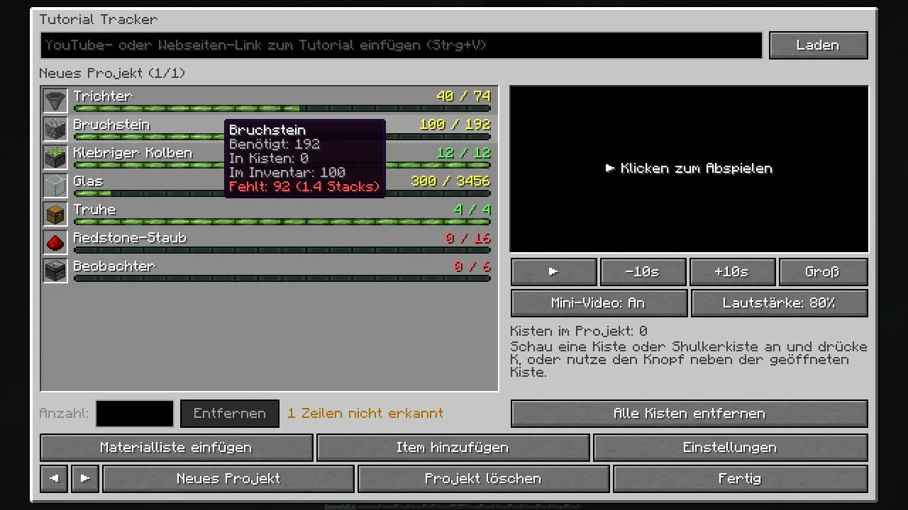
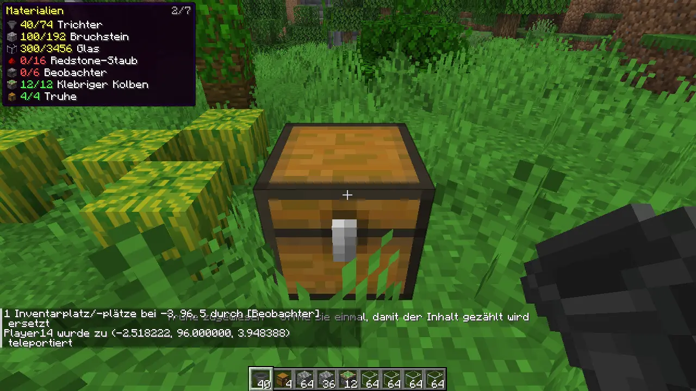
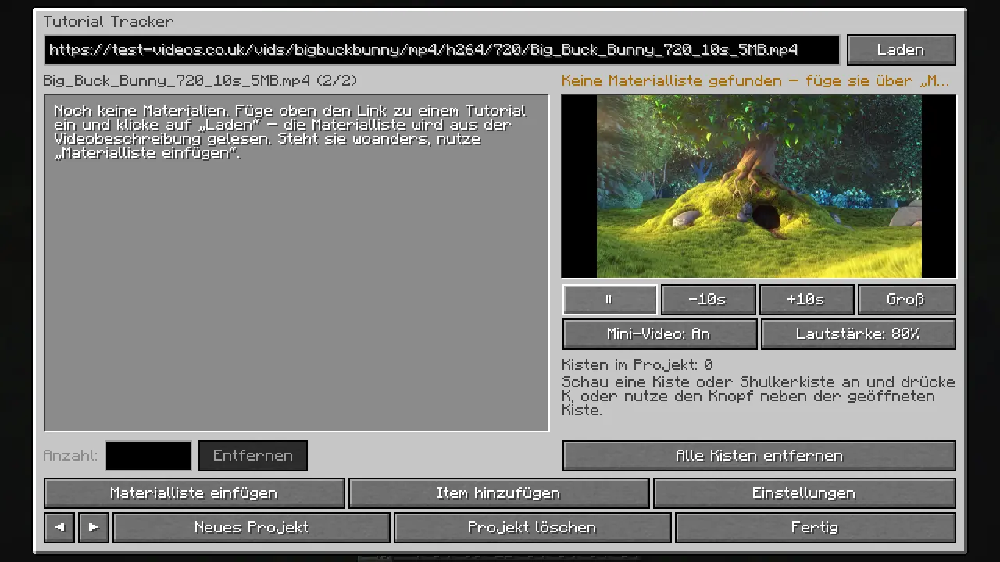
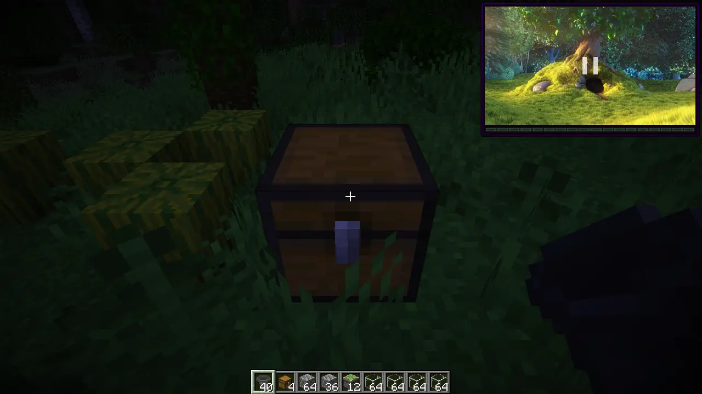
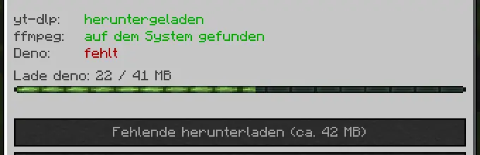

# Tutorial Tracker

Client-Mod für **Minecraft 26.3** (Fabric, NeoForge und Forge). Du fügst den Link zu einem Bau-Tutorial ein, die Mod
liest daraus die Materialliste und zeigt dir beim Bauen, wie viel du von allem schon hast. Dazu zählt sie den Inhalt
der Kisten und Shulkerkisten, die du dem Projekt zuweist. Das Video läuft direkt im Spiel, als kleines Fenster im HUD
oder groß. Es gibt keine Vorlage und kein Hologramm, nur Liste und Video.

Die Mod läuft nur auf dem Client. Auf dem Server muss nichts installiert sein, sie funktioniert also auch auf
fremden Servern.



## Funktionen

- **Materialliste aus dem Link.** Bei YouTube wird die Videobeschreibung gelesen, bei anderen Links der Text der
  Webseite. Erkannt werden Zeilen wie `64x Hopper`, `Hopper x 64`, `Hoppers: 64`, `3 stacks of cobblestone`,
  `2 Shulker of Glass`, `1.5k cobblestone` oder `10 Trichter`. Stacks, Shulkerkisten (27 Stacks) und Doppelkisten
  (54 Stacks) werden umgerechnet, mit der echten Stapelgröße des Items (16 Enderperlen sind ein Stack). Zeitstempel,
  Koordinaten, Seeds, Raten und Versionsnummern werden ignoriert. Gibt es einen Abschnitt „Materials:“ oder
  „Materialliste:“, zählt nur dieser.
- **Englische und deutsche Item-Namen.** Erkannt werden die englischen Namen, die Namen in deiner Spielsprache und
  übliche Kurzformen wie „planks“, „iron“ oder „slime“.
- **Selbst bearbeiten.** Steht die Liste in einem Kommentar oder woanders, fügst du sie über „Materialliste
  einfügen“ ein. Fehlende Items fügst du über eine Suche im Stil des Kreativinventars hinzu, Anzahlen änderst du per
  Klick. Zeilen, die die Mod nicht zuordnen konnte, siehst du im Tooltip.
- **Kisten und Shulkerkisten zählen.** Schau eine Kiste, ein Fass, eine Shulkerkiste oder deine Endertruhe an und
  drück **K**, oder nutz den Knopf „+ Zum Projekt“ neben der geöffneten Kiste. Weil die Mod nur auf dem Client
  läuft, sieht sie den Inhalt erst, wenn du die Kiste öffnest. Danach wird er bei jedem Öffnen aktualisiert und
  gespeichert. Shulkerkisten und Bündel werden mit ihrem Inhalt gezählt, egal ob sie im Inventar oder in einer Kiste
  liegen. Dein Inventar zählt ebenfalls mit (abschaltbar).
- **Liste im HUD.** Zeigt beim Bauen „vorhanden/benötigt“ für jedes Item: grün, wenn genug da ist, gelb bei einem
  Teil, rot bei nichts. Fehlendes steht oben.
- **Video im Spiel.** Als Mini-Player in einer Bildschirmecke, während du baust, oder groß mit Spulleiste.
  **J** pausiert und spielt weiter. Die Stelle, an der du aufgehört hast, wird pro Projekt gespeichert.
- **Mehrere Projekte.** Jedes Tutorial ist ein eigenes Projekt mit eigener Liste und eigenen Kisten.
- **Im Minecraft-Look.** Graue Inventarfenster, Slots, die XP-Leiste als Fortschrittsbalken und der Tooltip-Rahmen
  im HUD. Deutsch und Englisch.

| Beim Bauen: Liste im HUD | Kiste zuweisen |
|---|---|
|  |  |

| Video im Menü | Mini-Video im HUD |
|---|---|
|  |  |

## Installation

1. Lade die passende Datei für deinen Loader herunter:
   - `tutorial-tracker-fabric-1.0.0+26.3.jar` (benötigt die [Fabric API](https://modrinth.com/mod/fabric-api))
   - `tutorial-tracker-neoforge-1.0.0+26.3.jar`
   - `tutorial-tracker-forge-1.0.0+26.3.jar`
2. Leg sie in den `mods`-Ordner deiner Minecraft-26.3-Installation.

### Video-Player

Für Videos braucht die Mod drei kostenlose Programme: **yt-dlp** (findet den Videostream), **ffmpeg** (dekodiert Bild
und Ton) und **Deno** (braucht yt-dlp für YouTube). Sind sie schon installiert, werden sie direkt benutzt. Sonst
öffnest du *B → Einstellungen → Video-Player* und klickst „Fehlende herunterladen“. Die Programme landen einmalig in
`.minecraft/tutorialtracker/bin`, insgesamt etwa 80 bis 200 MB, je nach System. Funktionieren YouTube-Videos
irgendwann nicht mehr, hilft dort „yt-dlp aktualisieren“.

Materialliste und Kistenzählen funktionieren auch ohne diese Programme.



## Tasten

| Taste | Funktion |
|---|---|
| **B** | Tutorial-Menü öffnen (Link, Liste, Video, Projekte) |
| **K** | Angeschaute Kiste/Shulkerkiste dem Projekt zuweisen oder entfernen |
| **J** | Video abspielen/pausieren |
| **H** | Materialliste im HUD ein/aus |
| *frei* | Video 10 s zurück/vor, Video groß, Mini-Video ein/aus |

Alle Tasten lassen sich unter *Optionen → Steuerung → Tastenbelegung → Tutorial Tracker* ändern. Im großen
Video-Fenster pausiert die Leertaste, und die Pfeiltasten springen 5 Sekunden.

## Gut zu wissen

- **Erst öffnen, dann zählen:** Eine neu zugewiesene Kiste wird gezählt, sobald du sie einmal geöffnet hast. Das
  Menü zeigt, welche noch fehlen.
- **Shulkerkiste abgebaut?** Dann zählt sie dort, wo sie jetzt liegt (Inventar oder eine andere Kiste), und nicht
  mehr an ihrem alten Platz.
- **YouTube blockiert?** Manchmal zeigt YouTube statt der Seite eine Bot-Prüfung. Versuch es später noch einmal oder
  füge die Liste über „Materialliste einfügen“ ein.
- **Gespeichert wird** in `.minecraft/config/tutorialtracker/` (Einstellungen und Projekte als JSON).

## Selbst bauen

Du brauchst Java 25. Die Jars landen in `fabric/build/libs`, `neoforge/build/libs` und `forge/build/libs`.

```
./gradlew build
```

Zum Testen: `./gradlew :fabric:runClient`, `:neoforge:runClient` oder `:forge:runClient`.

## Lizenz

MIT, siehe [LICENSE](LICENSE).
