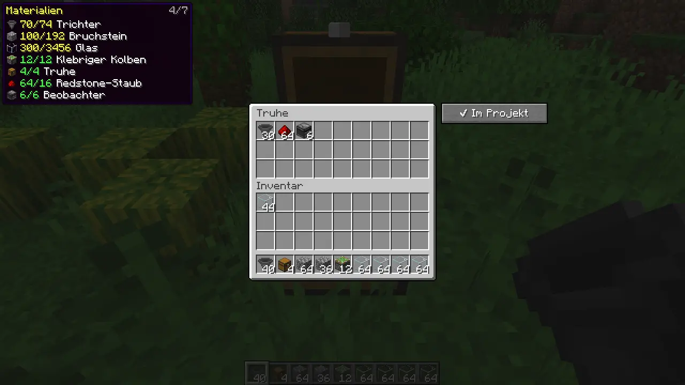
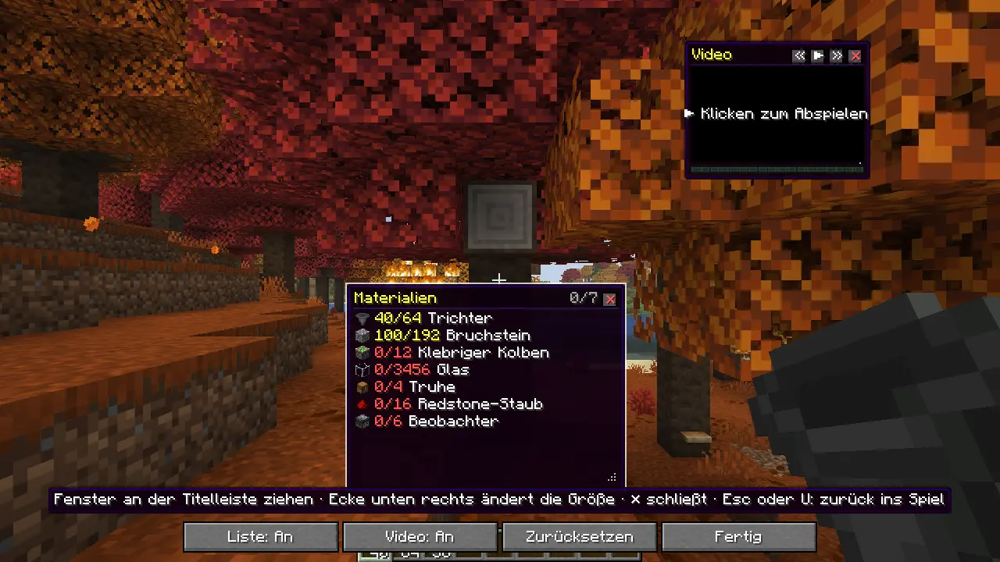

# Tutorial Tracker

Client mod for **Minecraft 26.3** (Fabric, NeoForge and Forge). Paste the link to a build tutorial and the mod reads
its material list, then shows you while you build how much of everything you already have. It counts the contents of
the chests and shulker boxes you assign to the project. The video plays right in the game, as a small window in the
HUD or full size. There is no schematic and no hologram, just the list and the video.

The mod runs on the client only. Nothing has to be installed on the server, so it works on other people's servers
too. It runs on Windows, macOS (Apple Silicon and Intel) and Linux.


## Features

- **Material list from the link.** For YouTube and Twitch the video description is read, for other links the text of
  the web page. It understands lines like `64x Hopper`, `Hopper x 64`, `Hoppers: 64`, `3 stacks of cobblestone`,
  `2 Shulker of Glass`, `1.5k cobblestone` or `10 Trichter`. Stacks, shulker boxes (27 stacks) and double chests
  (54 stacks) are converted using the item's real stack size (16 ender pearls are one stack). Timestamps,
  coordinates, seeds, rates and version numbers are ignored. If there is a "Materials:" section, only that counts.
- **English and German item names.** It recognises the English names, the names in your game language and common
  short forms such as "planks", "iron" or "slime".
- **Edit it yourself.** If the list is in a comment or somewhere else, add it with "Paste material list". Add missing
  items through a search styled like the creative inventory, and change amounts with a click. Lines the mod could not
  match are shown in the tooltip.
- **Count chests and shulker boxes.** Look at a chest, barrel, shulker box or your ender chest and press **K**, or use
  the "+ Add to project" button next to the open chest. Because the mod runs only on the client, it sees the contents
  once you open the chest. From then on they are updated and saved each time you open it. Shulker boxes and bundles
  are counted with their contents, whether they are in your inventory or in a chest. Your inventory counts as well
  (can be turned off).
- **List as a window.** Shows "have/needed" for each item while you build: green when there is enough, yellow for
  part of it, red for nothing. Missing items come first.
- **Video as a window.** A small player over the game while you build, or full size with a seek bar. **J** pauses and
  resumes. Where you stopped is saved per project.
- **YouTube and Twitch.** Besides YouTube videos, Twitch videos (VODs), clips and live streams play too. A live stream
  shows "● LIVE" instead of a time and jumps back to the current point after a pause.
- **Arrange the windows freely.** Press **U** (or "Arrange windows" in the menu). You get the mouse and can move the
  list and video by their title bar, drag the bottom right corner to make them larger or smaller, and close them with
  ✕. The video window has « ▶ » to seek and play. Esc or U takes you back to the game, and the windows stay where you
  put them.
- **Windows in the mod settings.** The settings (through **Mod Menu** on Fabric, the mod list on NeoForge and Forge,
  or *B → Settings*) show a small preview of the screen. There you drag the list and video into place and make them
  larger or smaller at the bottom right corner, even in the main menu without a world. For exact positions, click a
  window: the arrow keys move it (10 pixels with Shift), and with Alt (Option on a Mac) they change its size. Works
  with a trackpad and a Retina display too.
- **Several projects.** Each tutorial is its own project with its own list and its own chests.
- **Archive.** Every loaded list as a card with a preview picture, the name of the farm, the Minecraft version and the
  number of materials (*B → Archive*). The archive keeps its cards even when you delete the project. Double-click or
  "Open" creates the project again. Below it you change the name and version; "Remove from archive" removes only the
  card. The mod detects the version from the video's title or description when loading.
- **Share with friends.** "Copy code" puts the list, link and version on the clipboard as a short code that fits in a
  Discord message. Your friend copies the message and clicks "Paste code" in the archive.
- **Minecraft look, light or dark.** Grey inventory windows, slots, the XP bar as a progress bar and the tooltip frame
  in the HUD. *Settings → Design* has a dark mode. English and German.
- **Easy on FPS.** Saving happens in the background, counting only when something changed, and the list is only
  rebuilt when something changes.
- **Updates itself.** At startup the mod looks on GitHub for a new version for your Minecraft version and loader,
  downloads it and swaps it in when the game closes. Can be turned off under *Settings → Auto-update*.

| While building: list as a window | Assigning a chest |
|---|---|
|  |  |



| Video in the menu | Mini video in the HUD |
|---|---|
|  |  |

The screenshots show the German interface; with the game set to English, the mod is in English too.

## Installation

1. Download the file for your loader from the [releases](https://github.com/Luna-OS/minecraft-Tutorial-Helper-Mod/releases):
   - `tutorial-tracker-fabric-<version>+26.3.jar` (needs the [Fabric API](https://modrinth.com/mod/fabric-api))
   - `tutorial-tracker-neoforge-<version>+26.3.jar`
   - `tutorial-tracker-forge-<version>+26.3.jar`
2. Put it in the `mods` folder of your Minecraft 26.3 installation.

### Video player

For videos the mod needs three free programs: **yt-dlp** (finds the video stream), **ffmpeg** (decodes picture and
sound) and **Deno** (yt-dlp needs it for YouTube). If they are already installed, they are used directly. Otherwise
open *B → Settings → Video player* and click "Download missing". The programs are placed once in
`.minecraft/tutorialtracker/bin`, about 80 to 200 MB in total depending on the system. If YouTube videos stop working
at some point, "Update yt-dlp" there helps.

**On a Mac** the mod also finds programs installed with Homebrew (`brew install yt-dlp ffmpeg deno`) or MacPorts. The
downloaded programs are available for Apple Silicon and Intel. Gatekeeper does not block them.

The material list and chest counting work without these programs.


## Keys

| Key | Action |
|---|---|
| **B** | Open the tutorial menu (link, list, video, projects) |
| **K** | Assign the chest/shulker box you are looking at to the project, or remove it |
| **J** | Play/pause the video |
| **H** | Material list on/off |
| **U** | Arrange windows: free the mouse, move and resize the list and video |
| *unbound* | Video 10 s back/forward, full size video, mini video on/off |

All keys can be changed under *Options → Controls → Key Binds → Tutorial Tracker*. In the full size video, Space
pauses and the arrow keys jump 5 seconds. While arranging, the arrow keys move the clicked window, and with Alt
(Option on a Mac) they change its size.

## Good to know

- **Open first, then it counts:** A newly assigned chest is counted once you have opened it. The menu shows which are
  still missing.
- **Broke a shulker box?** Then it counts where it is now (your inventory or another chest), no longer at its old
  place.
- **YouTube blocked?** Sometimes YouTube shows a bot check instead of the page. Try again later or add the list with
  "Paste material list".
- **Twitch picture green or black?** An old ffmpeg (before version 7) cannot read Twitch. The mod therefore ignores it
  and offers its own download under *B → Settings → Video player*.
- **Download error on Windows?** Usually the virus scanner briefly holds the freshly downloaded file. Wait a few
  seconds and click the button again.
- **Data is saved** in `.minecraft/config/tutorialtracker/` (settings, projects and archive as JSON).

## Building

You need Java 25. The jars end up in `fabric/build/libs`, `neoforge/build/libs` and `forge/build/libs`.

```
./gradlew build
```

To test: `./gradlew :fabric:runClient`, `:neoforge:runClient` or `:forge:runClient`.

## License

MIT, see [LICENSE](LICENSE).
